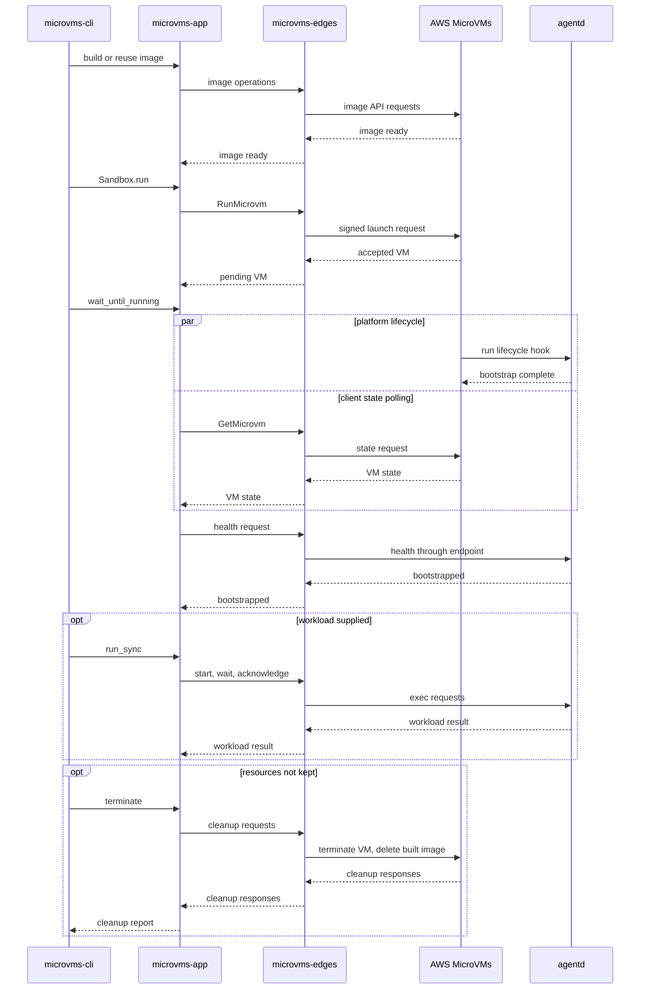
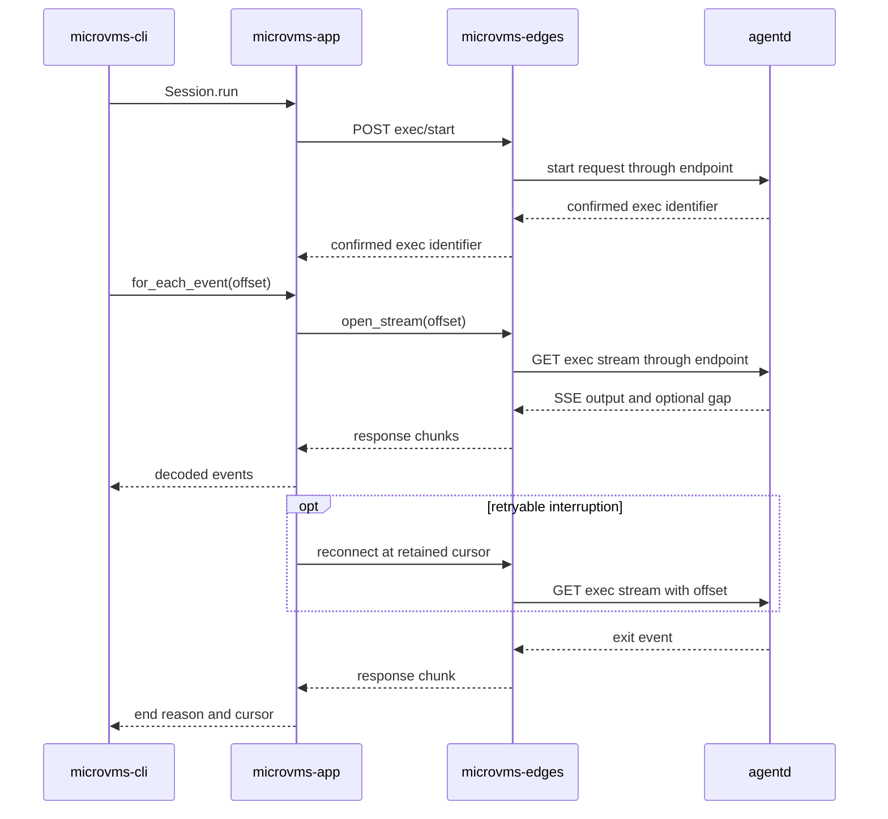
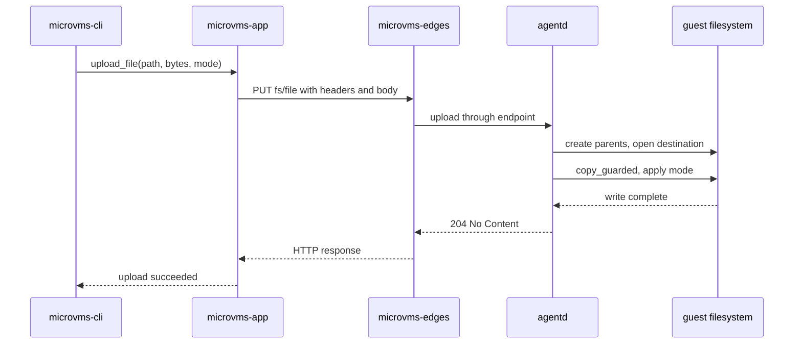

# microvms-agentd · Data flow

## Flow 1: Build, launch, execute, and clean up

1. `lifecycle::run` opens a sandbox and races `launch_and_exec` against the interrupt future while retaining the sandbox for cleanup. `crates/microvms-cli/src/commands/lifecycle.rs:435`, `crates/microvms-cli/src/commands/lifecycle.rs:630-676`
2. `launch_and_exec` selects an existing image, builds from the supplied artifact, or calls `ensure_image` to build or reuse a content-addressed image. `crates/microvms-cli/src/commands/lifecycle.rs:1008-1092`
3. `Sandbox::run` constructs the launch payload, resolves the image identifier, calls the control plane, and records the accepted VM as pending. `crates/microvms-app/src/sandbox.rs:1108`, `crates/microvms-app/src/sandbox.rs:1172-1228`
4. `ControlPlane::run_microvm` serializes `RunMicrovm`; the production `SignedTransport::send` signs the request and sends it to AWS. `crates/microvms-app/src/control/microvm.rs:433-469`, `crates/microvms-edges/src/control/transport.rs:153-203`
5. The daemon's `run_hook` receives the platform envelope, installs the bootstrap state, and runs the configured run handler before returning success. `crates/agentd/src/routes.rs:221-313`
6. Unless `--no-wait` is set, `Sandbox::wait_until_running` waits for the launch state and then calls `Session::wait_until_ready` to poll for bootstrap readiness. `crates/microvms-cli/src/commands/lifecycle.rs:1151-1165`, `crates/microvms-app/src/sandbox.rs:1280-1309`, `crates/microvms-app/src/control/microvm.rs:666-730`, `crates/microvms-app/src/session/mod.rs:410-438`
7. When `--exec` is supplied, `launch_and_exec` calls `Session::run_sync` to start the workload, wait for its result, and acknowledge it. `crates/microvms-cli/src/commands/lifecycle.rs:1187-1207`, `crates/microvms-app/src/session/mod.rs:476-482`
8. The CLI calls `tear_down` after the launch attempt; `--keep` retains resources, otherwise it requests termination and deletion of the image this run built. `crates/microvms-cli/src/commands/lifecycle.rs:737-744`, `crates/microvms-cli/src/commands/lifecycle.rs:1297-1344`

## Flow 2: Stream command output

1. `attached::exec` attaches a session, starts the requested command, and selects `stream_exec` when `--stream` is set. `crates/microvms-cli/src/commands/attached.rs:243-342`
2. `Session::run` sends `POST /v1/exec/start` and returns an `ExecHandle` using the daemon's confirmed exec identifier. `crates/microvms-app/src/session/mod.rs:448-467`
3. `stream_exec` passes the requested offset to `ExecHandle::for_each_event` and renders each received output, gap, or exit event. `crates/microvms-cli/src/commands/attached.rs:479-534`
4. `for_each_event` delegates to `for_each_event_async`, which drives `advance` and retains its cursor for the final stream result. `crates/microvms-app/src/session/exec.rs:483-590`
5. `ExecHandle::attach` adds request headers and opens `GET /v1/exec/{id}/stream?offset=N` through the backend; `ReqwestBackend::open_stream` returns the response header and chunk source. `crates/microvms-app/src/session/exec.rs:727-751`, `crates/microvms-edges/src/session/http.rs:140-183`
6. The daemon's `stream` handler looks up the exec, snapshots its replay buffer, and constructs an SSE response from `build_stream`. `crates/agentd/src/exec.rs:477-514`
7. `build_stream` emits a gap when needed, drains replayed output, follows live output, and ends with the exec's terminal event. `crates/agentd/src/exec.rs:584-640`
8. On a retryable interruption, `advance` can reconnect from the retained cursor within the configured retry limit; the callback driver returns the end reason and cursor to the CLI. `crates/microvms-app/src/session/exec.rs:539-590`, `crates/microvms-app/src/session/exec.rs:596-650`

## Flow 3: Upload a file with microvm cp

1. `attached::cp` resolves the `vm:` side, attaches a session, and reads the local file for an upload. `crates/microvms-cli/src/commands/attached.rs:1470-1504`
2. For an upload without `--tar`, `cp` calls `Session::upload_file` with the remote path, bytes, and optional mode. `crates/microvms-cli/src/commands/attached.rs:1507-1512`
3. `Session::upload_file` delegates to `files::upload_file`, which constructs a `PUT /v1/fs/file` request with an octet-stream body. `crates/microvms-app/src/session/mod.rs:505-512`, `crates/microvms-app/src/session/files.rs:65-77`
4. `Transport::request_inner` combines session and caller headers before sending through the backend; `ReqwestBackend::send` collects the HTTP response. `crates/microvms-app/src/session/mod.rs:139-155`, `crates/microvms-edges/src/session/http.rs:117-137`
5. The daemon router maps `PUT /v1/fs/file` to `fs::write_file`. `crates/agentd/src/routes.rs:151-177`
6. `write_file` parses the request, checks available disk space, creates missing parents, and opens the destination for replacement. `crates/agentd/src/fs.rs:1199-1249`
7. `write_file` streams the request body through `disk::copy_guarded`, applies a requested mode, and returns `204 No Content` on success. `crates/agentd/src/fs.rs:1257-1308`
8. The application's `Transport::send` checks the response status before `upload_file` returns success to the CLI. `crates/microvms-app/src/session/mod.rs:159-164`, `crates/microvms-app/src/session/files.rs:65-77`

## See also

These pages cite many of the same source files as this one.

- [contract map](../insights/contract-map.md)
- [processes](../behavior/processes.md)
- [impact analysis](../insights/impact-analysis.md)
- [module map](module-map.md)
- [components](../diagrams/architecture/components.md)
