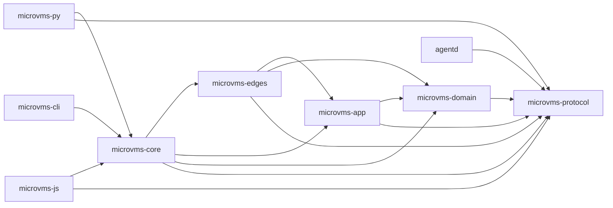

# microvms-agentd · System overview

`microvms-agentd` provides a guest daemon and client libraries for applications that run work in AWS Lambda MicroVMs: image preparation, VM lifecycle management, command execution, and file transfer belong to the same client stack. `crates/microvms-app/src/lib.rs:4` `crates/microvms-app/src/session/mod.rs:448` `crates/microvms-app/src/session/mod.rs:505`
The guest process is `agentd`, started as the container's `CMD`; the host-facing entry points are the `microvm` executable and Rust, Python, and JavaScript bindings around the shared client implementation. `crates/agentd/src/main.rs:4` `crates/microvms-cli/Cargo.toml:21` `bindings/microvms-py/Cargo.toml:26` `bindings/microvms-js/Cargo.toml:20`

The client architecture separates decisions from external effects: `microvms-domain` holds sizing, cost, region, name, and error rules, while `microvms-app` composes use cases against ports for transport, storage, time, and other dependencies. `crates/microvms-domain/src/lib.rs:4` `crates/microvms-app/src/lib.rs:4`
`microvms-edges` supplies production implementations for signed HTTP requests, sockets, the local name registry, release retrieval, and the clock; `microvms-core` wires those implementations into constructors and re-exports the public types. `crates/microvms-edges/src/lib.rs:7` `crates/microvms-core/src/lib.rs:77`
The CLI and bindings depend on core, while `agentd` shares the `microvms-protocol` wire types with the client and has no dependency on the client implementation. `crates/microvms-cli/Cargo.toml:38` `bindings/microvms-py/Cargo.toml:26` `bindings/microvms-js/Cargo.toml:20` `crates/agentd/Cargo.toml:20`

A typical workflow prepares an image, launches it through `Sandbox`, waits for the VM and daemon to become ready, and then uses the resulting `Session` for commands or file operations. `crates/microvms-app/src/sandbox.rs:917` `crates/microvms-app/src/sandbox.rs:1105` `crates/microvms-app/src/sandbox.rs:1262` `crates/microvms-app/src/session/mod.rs:448`
A session starts a command without waiting for completion and returns an execution handle; callers can consume its event stream or use the synchronous-result helper, which awaits completion and acknowledges the output. `crates/microvms-app/src/session/mod.rs:443` `crates/microvms-app/src/session/exec.rs:421` `crates/microvms-app/src/session/mod.rs:476`
Callers can also recover an execution handle from a known ID, separating the process identity from the lifetime of a client handle. `crates/microvms-app/src/session/mod.rs:471`
File operations cover individual byte buffers and tar archives for directory trees, alongside remote existence queries and line-range reads. `crates/microvms-app/src/session/mod.rs:505` `crates/microvms-app/src/session/mod.rs:523` `crates/microvms-app/src/session/mod.rs:533` `crates/microvms-app/src/session/mod.rs:538`
Lifecycle ownership is explicit: teardown returns a report of its outcome, and dropping a sandbox only warns about a live VM rather than initiating asynchronous cleanup. `crates/microvms-app/src/sandbox.rs:1772` `crates/microvms-app/src/sandbox.rs:1917`

Each interface adapts that shared behavior to its caller: the CLI parses commands and renders results, Python exposes blocking calls and coroutine twins, and the Node binding maps asynchronous operations to JavaScript promises. `crates/microvms-cli/src/main.rs:80` `bindings/microvms-py/src/session.rs:1001` `bindings/microvms-py/src/session.rs:1006` `bindings/microvms-js/src/session.rs:708` `bindings/microvms-js/src/lib.rs:60`
For automation, `microvm manifest` derives command and option descriptions from the parser; streaming execution describes its stdout as newline-delimited events followed by the final envelope. `crates/microvms-cli/src/manifest.rs:51` `crates/microvms-cli/src/manifest.rs:58`
The daemon builds its router at startup and runs it on a current-thread Tokio runtime, keeping the guest entry point separate from the host applications' runtimes. `crates/agentd/src/main.rs:24` `crates/agentd/src/main.rs:77`

The architecture supports tests that replace the application's ports with shared test doubles, while production construction remains in core's prelude. `crates/microvms-app/src/lib.rs:34` `crates/microvms-core/src/prelude.rs:136`
The workspace also contains `agentd-model` for state exploration and `model-conformance` for comparisons with the implementation; dependency-direction tests assert the allowed package relationships so these verification layers do not redefine the production architecture. `crates/model/Cargo.toml:7` `crates/model-conformance/Cargo.toml:8` `crates/microvms-cli/tests/dependency_direction.rs:25`

## Stack

| Layer | Technology | Source |
| --- | --- | --- |
| Language | Rust, `edition = "2024"` | `Cargo.toml:30` |
| Toolchain | `channel = "1.99.0"` | `rust-toolchain.toml:22` |
| Guest HTTP | `axum = { version = "0.8.9", features = ["ws"] }` | `crates/agentd/Cargo.toml:25` |
| Asynchronous runtime | `tokio = { version = "1.53", features = ["time", "sync", "io-util", "macros", "rt"] }` | `crates/microvms-app/Cargo.toml:33` |
| Host HTTP | `reqwest` with `version = "0.13"` and `"rustls"` | `crates/microvms-edges/Cargo.toml:58` |
| Wire schema | `schemars` with `version = "1.2.2"` and `["derive", "std"]` | `crates/protocol/Cargo.toml:24` |
| CLI parsing | `clap = { version = "4.6.6", features = ["derive"] }` | `crates/microvms-cli/Cargo.toml:46` |
| Python extension | `pyo3` with `version = "0.29"` and `["abi3-py39", "experimental-async"]` | `bindings/microvms-py/Cargo.toml:45` |
| Node extension | `napi` with `version = "3"` and `"napi5"`, `"async"`, `"web_stream"` | `bindings/microvms-js/Cargo.toml:43` |
| State exploration | `stateright = "0.31"` | `crates/model/Cargo.toml:14` |

## Module map

Arrows represent declared production dependencies between workspace packages. `crates/microvms-core/Cargo.toml:20` `crates/microvms-edges/Cargo.toml:23` `crates/microvms-app/Cargo.toml:22` `crates/microvms-domain/Cargo.toml:21` `crates/agentd/Cargo.toml:20` `crates/microvms-cli/Cargo.toml:38` `bindings/microvms-py/Cargo.toml:26` `bindings/microvms-js/Cargo.toml:20`

## See also

- [dependency graph](../diagrams/structural/dependency-graph.md): 19 shared source citations
- [module map](module-map.md): 12 shared source citations
- [ownership](../analysis/ownership.md): 9 shared source citations
- [impact analysis](../insights/impact-analysis.md): 8 shared source citations
- [contract map](../insights/contract-map.md): 7 shared source citations
