# microvms-agentd · State machines

The diagrams project explicit enum-valued state fields. Model diagrams describe the model's transitions; implementation diagrams describe assignments in the app. The lifecycle model names its mirror explicitly, while the stream has its own private enum (`crates/model/src/client.rs:60-78`, `crates/microvms-app/src/session/exec.rs:872-887`).

Transition labels use source event or function identifiers. Payloads and guards are explained beside each diagram; an unchanged enum value can still carry changed data (`crates/model/src/lib.rs:94-103`, `crates/model/src/client.rs:154-192`).

## Boot

The daemon model starts at `Uninitialized`. `RunHook` installs `Ready`; later hooks keep that state, with the response determined by the supplied value. The boot model has no terminal state (`crates/model/src/lib.rs:247-256`, `crates/model/src/lib.rs:325-340`).

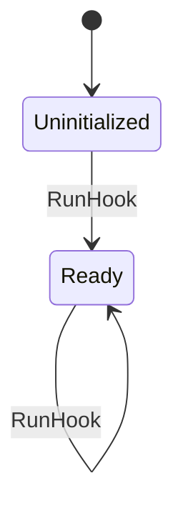

Defined at: `crates/model/src/lib.rs:73-78`

## ClientPhase

The tunnel model initializes the client at `Idle`; `ClientHello` starts the handshake. `Deliver` invokes `client_reads`, which accepts a reply into `Relaying` or ends the relay at `Done`. During relay, delivered bytes preserve the phase, while an end, close, transport loss, or rejected frame can finish it. `ClientLocalEof` also finishes the relay; `Done` carries the result (`crates/model/src/tunnel.rs:433-494`, `crates/model/src/tunnel.rs:625-635`, `crates/model/src/tunnel.rs:735-780`, `crates/model/src/tunnel.rs:831-841`).

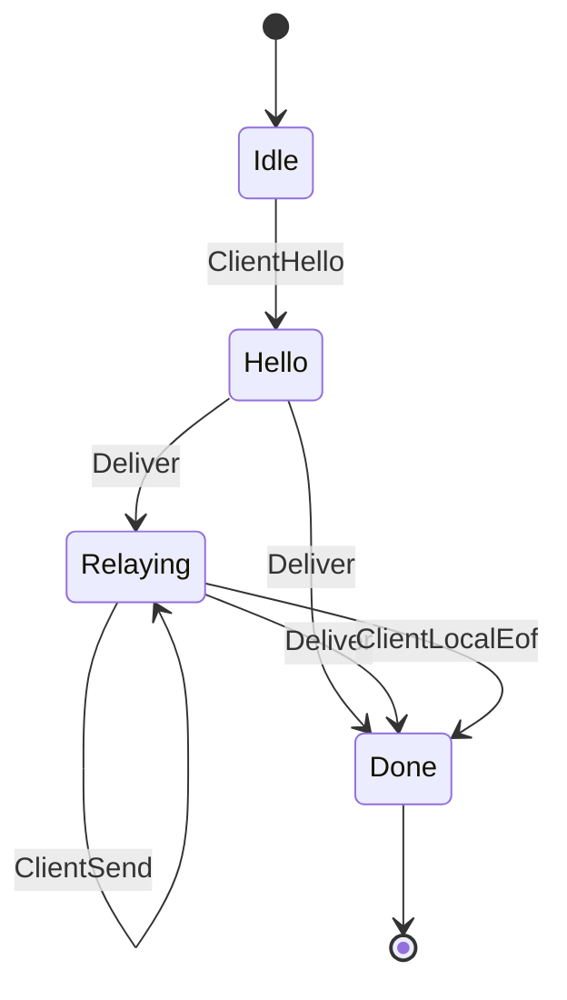

Defined at: `crates/model/src/tunnel.rs:270-276`

## ExecPhase

An accepted `ExecStart` creates `Running`; retries retain the existing phase. `ChildExit` produces `Exited`, `ExecAck` releases output and produces `Acked`, and `Collect` removes an acknowledged entry. Polls preserve the phase. The diagram assumes a control request has passed the model's request gate (`crates/model/src/lib.rs:343-419`).

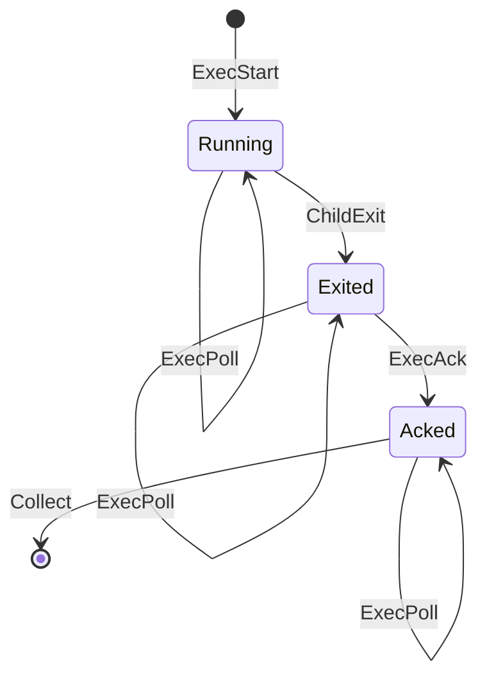

Defined at: `crates/model/src/lib.rs:83-90`

## GuestRead

The tunnel model initializes the guest connection at `Open`. A delivered end marker and the guest's own EOF produce `Eof`. `caller_vanished` leaves the guest at `Open` when the daemon never connected to the guest port, and otherwise chooses `Reset` or `Eof` according to the negotiated end-of-stream behavior. These transitions also mark the daemon side done (`crates/model/src/tunnel.rs:503-518`, `crates/model/src/tunnel.rs:576-612`, `crates/model/src/tunnel.rs:637-651`, `crates/model/src/tunnel.rs:797-816`).

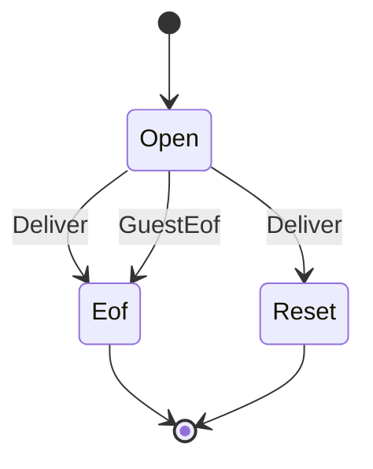

Defined at: `crates/model/src/tunnel.rs:174-178`

## Lifecycle

A new `Sandbox` starts at `Pending`; `run` records an accepted launch there, and `wait_until_running` records `Running`. `suspend` first records `Suspending`, then `Suspended` or `Terminated` when its wait settles. `resume` records `Running` after its wait succeeds (`crates/microvms-app/src/sandbox.rs:769-770`, `crates/microvms-app/src/sandbox.rs:1212-1227`, `crates/microvms-app/src/sandbox.rs:1284-1313`, `crates/microvms-app/src/sandbox.rs:1585-1639`, `crates/microvms-app/src/sandbox.rs:1669-1716`).

The diagram shows the launch-driven path. `adopt` instead initializes the handle from any recognized service state. `terminate` writes `Terminating` whenever the handle still has a VM record, including on repeated calls, and only a successful requested termination wait writes `Terminated`. Consequently, `Terminated` is not an absorbing enum state. Detachment and other flags can refuse an operation without changing this enum (`crates/microvms-app/src/sandbox.rs:1388-1426`, `crates/microvms-app/src/sandbox.rs:1500-1543`, `crates/microvms-app/src/sandbox.rs:1742-1793`).

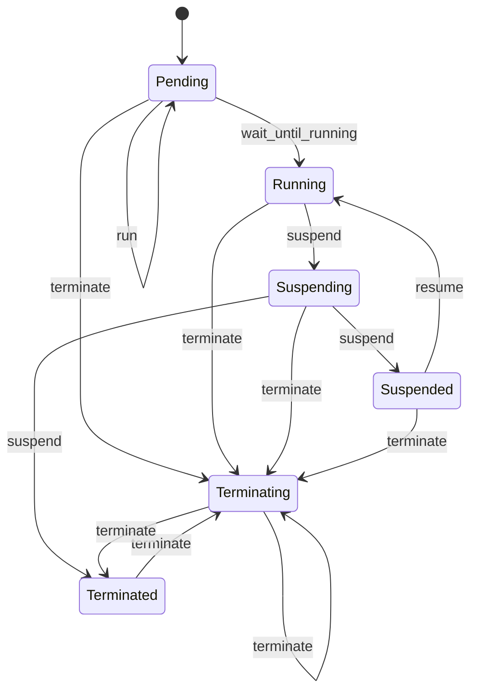

Defined at: `crates/microvms-app/src/sandbox.rs:137-151`

## OutputEnd

`output::End` is the output model's process state, initialized to `Running`. `Exit` chooses the terminal result through the configured output policy. The model also represents write-policy alternatives: `write` can move directly to `Panicked` or `Signaled`. Those alternatives are model outcomes, not a claim that the current CLI follows those policies (`crates/model/src/output.rs:347-383`, `crates/model/src/output.rs:396-439`, `crates/model/src/output.rs:509-526`).

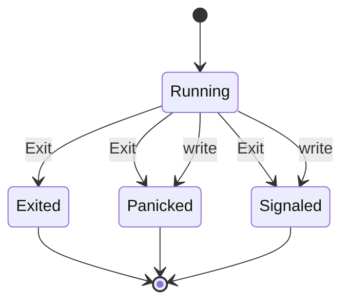

Defined at: `crates/model/src/output.rs:88-97`

## Pc

The image model's caller starts at `Describe`. The diagram follows `Behavior::Specified`: each `Step` evaluates the current image and advances that caller. A ready image can return immediately; builds wait; deletions wait for absence; a refused create goes to `Redescribe`. A disappearance allows another describe, but a repeated disappearance reaches `Done`. Other configured model behaviors are excluded from this diagram (`crates/model/src/image.rs:149-164`, `crates/model/src/image.rs:233-340`, `crates/model/src/image.rs:387-407`).

`Done` carries `Returned`, `BuildFailed`, or `Vanished` on this path. A forced caller that has already deleted once joins the image it next finds; the `then_delete` payload distinguishes the waiting branches (`crates/model/src/image.rs:247-283`, `crates/model/src/image.rs:309-340`).

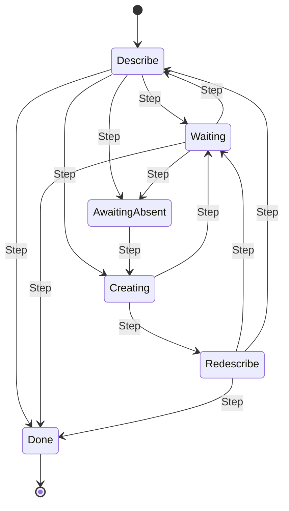

Defined at: `crates/model/src/image.rs:108-123`

## Platform

The image model initializes the shared platform as `Absent`, `Building`, `Ready`, or `Failed`. A caller's `Step` can create an absent image or delete a ready or failed image; the platform's own events settle the build and finish deletion. The platform model has no absorbing state because callers can reuse the name (`crates/model/src/image.rs:291-300`, `crates/model/src/image.rs:343-357`, `crates/model/src/image.rs:365-383`, `crates/model/src/image.rs:404-420`).

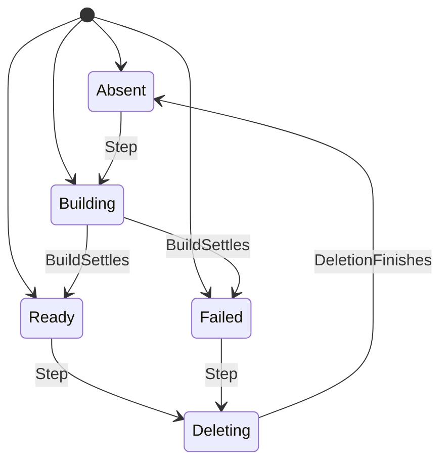

Defined at: `crates/model/src/image.rs:44-53`

## PosturePhase

`posture::Phase` tracks a launch while options are composed. Option changes and `Predict` retain `Composing`; `Launch` produces either `Refused` or `Launched`. `Adopt` changes the model's recorded report while preserving `Launched`. Neither result returns to composition (`crates/model/src/posture.rs:345-415`).

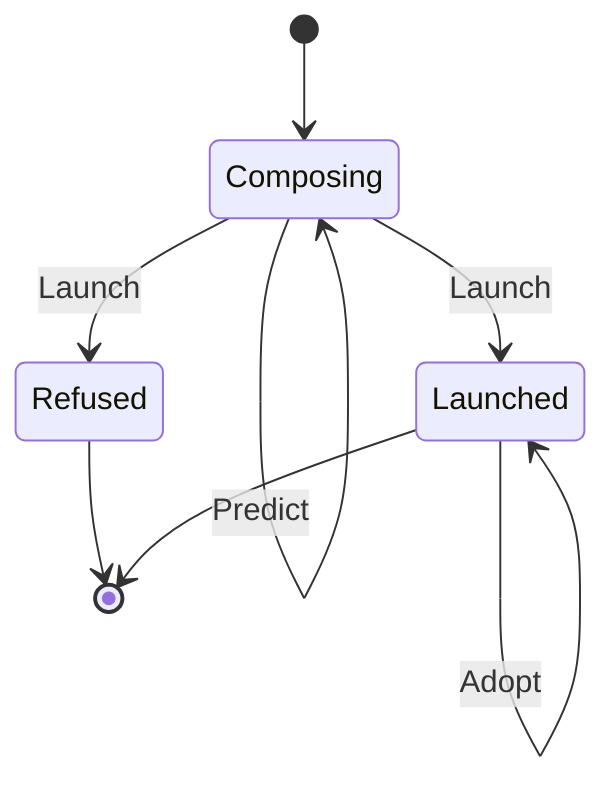

Defined at: `crates/model/src/posture.rs:254-261`

## PreflightStep

The preflight model starts at `Region` and advances through each report stage. A stage that cannot perform its probe still advances while recording `NotRun`; the report derives `ok` and reaches `Done` (`crates/model/src/preflight.rs:141-175`, `crates/model/src/preflight.rs:177-240`).

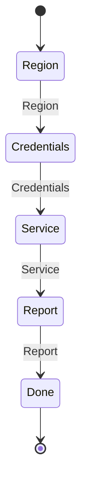

Defined at: `crates/model/src/preflight.rs:95-101`

## ProvisionPhase

`provision::Phase` starts at `Idle`. A request answered by a supplied binary or cache entry stays idle; a request that needs a fetch enters `Fetching`. `Download` moves to `Downloaded`, and both `Verify` and the modeled `Crash` return to idle with an outcome. `Tamper` changes cache data without changing the phase. The model has no terminal phase because subsequent requests are modeled (`crates/model/src/provision.rs:364-426`, `crates/model/src/provision.rs:429-462`, `crates/model/src/provision.rs:505-565`, `crates/model/src/provision.rs:568-606`).

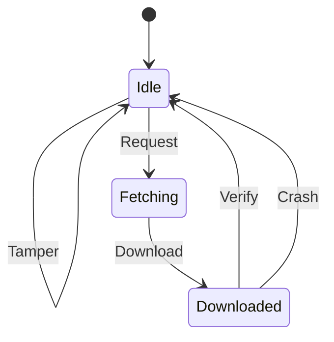

Defined at: `crates/model/src/provision.rs:233-241`

## RunStep

The run-to-completion model starts at `Start`. Under `Behavior::Specified`, an accepted start streams when a callback is present and waits otherwise. An exit event triggers acknowledgment; a cut or failed acknowledgment falls back to waiting. A client deadline triggers kill and a grace-period acknowledgment. `Done` means the call has returned a result or raised an error (`crates/model/src/run.rs:376-390`, `crates/model/src/run.rs:397-461`, `crates/model/src/run.rs:465-549`).

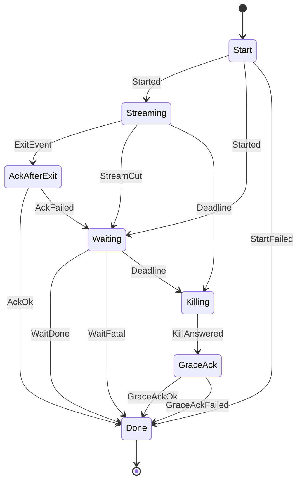

Defined at: `crates/model/src/run.rs:225-241`

## StartStep

The exec-start model's request phase is `Idle` until `Receive`, then `Resolved` after `Resolve`, and `Answered` after `Answer`. `Spawn` records a child without advancing the request phase; under the specified behavior it is offered after successful resolution. Boot and hook actions prepare the model before it offers requests (`crates/model/src/exec_start.rs:781-830`, `crates/model/src/exec_start.rs:833-880`).

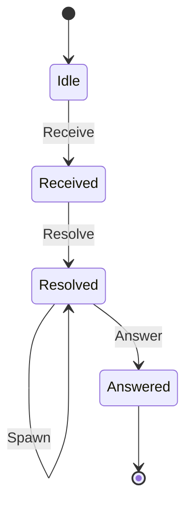

Defined at: `crates/model/src/exec_start.rs:667-676`

## StreamState

The app's output stream starts at `Reconnect` with the requested offset and no retries. `attach` succeeds into `Attached`, retries eligible errors when reconnecting is enabled, or ends at `Done`. The retry budget is checked before another attach (`crates/microvms-app/src/session/exec.rs:436-440`, `crates/microvms-app/src/session/exec.rs:548-552`, `crates/microvms-app/src/session/exec.rs:603-648`).

While attached, `Output` advances the cursor to the maximum observed end offset. `Gap` advances it to at least `to` and ends at `Done` when `error_on_gap` is set. `Exit` ends the stream. `next_event` returning no event reconnects or returns from the stream immediately, according to `reconnect`; a retryable read error also reconnects when enabled. A non-retried read error produces `Done` (`crates/microvms-app/src/session/exec.rs:650-720`).

The direct arrow from `Attached` to the final marker represents the no-event path with reconnecting disabled; that branch returns `None` without constructing `Done` (`crates/microvms-app/src/session/exec.rs:704-712`).

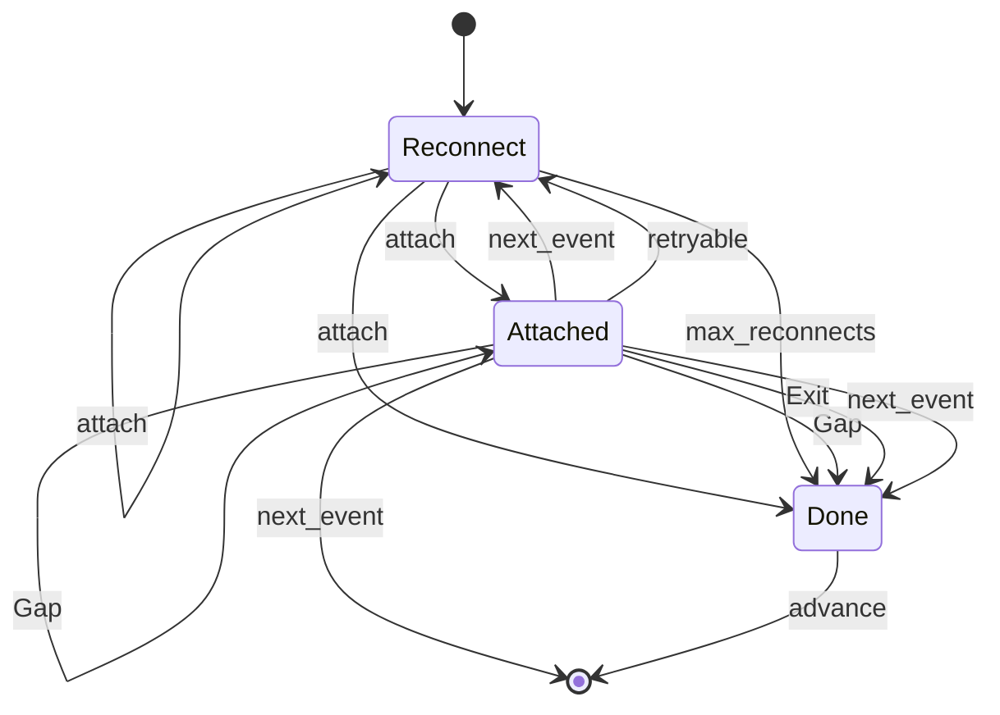

Defined at: `crates/microvms-app/src/session/exec.rs:874-887`

## VmState

The client model mirrors the lifecycle vocabulary and starts at `Pending`. The diagram uses its guarded configuration: `LaunchAccepted` keeps the pending state; `HookSucceeded` starts the VM; suspend and resume actions progress through their corresponding phases. `ResumeRequested` keeps `Suspended` and records an in-flight resume while the platform still has the VM. `SuspendedVmEnded` sets the platform-ended flag without changing the client's `Suspended` state. Once `SuspendedVmEnded` has recorded that the platform ended the suspended VM, the service refuses the request and the model writes `Terminated` (`crates/model/src/client.rs:60-78`, `crates/model/src/client.rs:295-313`, `crates/model/src/client.rs:390-532`).

`TerminateRequested` writes `Terminating` and clears an in-flight resume; `TerminateComplete` writes `Terminated`. The request is offered before the first termination, including during suspension. In the guarded model, the completed termination is absorbing. A late resume completion changes nothing once its preconditions no longer hold (`crates/model/src/client.rs:352-383`, `crates/model/src/client.rs:516-553`).

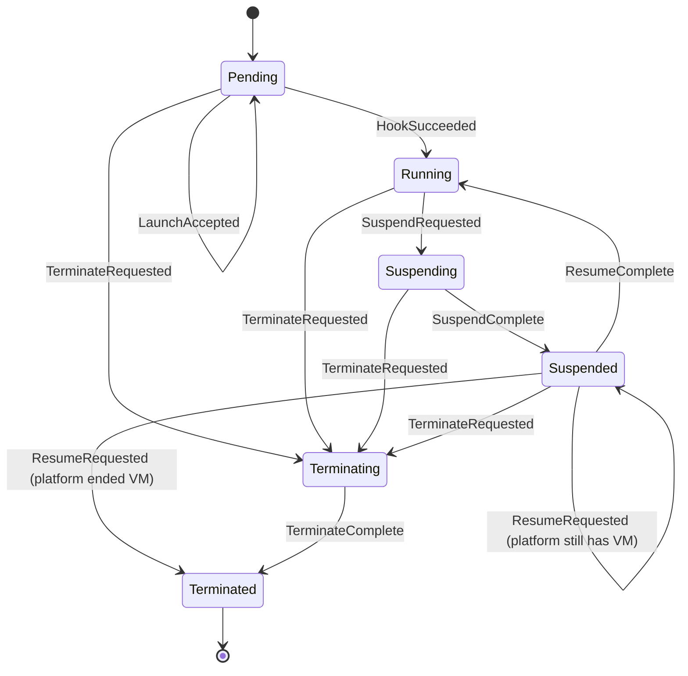

Defined at: `crates/model/src/client.rs:65-78`

## WrapPhase

The Dockerfile-wrapping model starts at `Composed`. `Wrap` yields `Wrapped` carrying either wrapped content or a refusal. Only wrapped content can proceed through `Check` to `Checked`; a refusal ends in `Wrapped`, while `Checked` has no further actions (`crates/model/src/wrap.rs:338-373`).

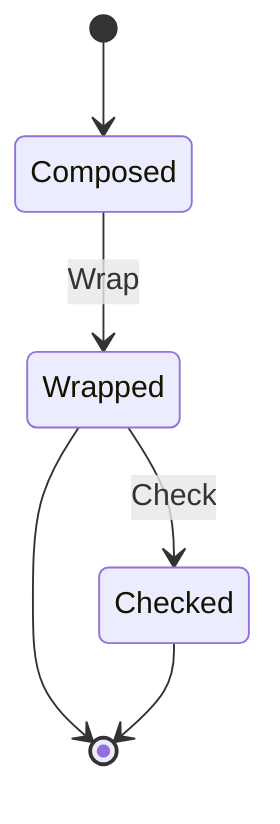

Defined at: `crates/model/src/wrap.rs:256-263`

## See also

These pages cite many of the same source files as this one.

- [module map](../architecture/module-map.md)
- [data flow](../architecture/data-flow.md)
- [system overview](../architecture/system-overview.md)
- [processes](processes.md)
- [components](../diagrams/architecture/components.md)
