# microvms-agentd · Components

```mermaid
classDiagram
    direction LR

    %% + lists selected operations, not Rust visibility.
    namespace microvms-cli {
        %% Trait and methods: `crates/microvms-cli/src/seam.rs:135-152`.
        class CoreSeam {
            <<interface>>
            +control_plane(region)
            +open_sandbox(region, port)
            +attach_session(region, attach)
        }
    }

    namespace microvms-app {
        %% Type: `crates/microvms-app/src/sandbox.rs:628`.
        %% Methods: `crates/microvms-app/src/sandbox.rs:922`, `crates/microvms-app/src/sandbox.rs:1111`, `crates/microvms-app/src/sandbox.rs:1583`, `crates/microvms-app/src/sandbox.rs:1667`, `crates/microvms-app/src/sandbox.rs:1775`.
        class Sandbox {
            +build_image(request)
            +run(request)
            +suspend()
            +resume()
            +terminate(opts)
        }
        %% Type: `crates/microvms-app/src/control/mod.rs:130`.
        %% Methods: `crates/microvms-app/src/control/image.rs:188`, `crates/microvms-app/src/control/microvm.rs:433`, `crates/microvms-app/src/control/microvm.rs:609`, `crates/microvms-app/src/control/microvm.rs:896`, `crates/microvms-app/src/control/microvm.rs:914`.
        class ControlPlane {
            +create_image(request)
            +run_microvm(request)
            +wait_for_running(id, opts)
            +terminate(id)
            +mint_auth_token(id)
        }
        %% Type: `crates/microvms-app/src/session/mod.rs:229`.
        %% Methods: `crates/microvms-app/src/session/mod.rs:392`, `crates/microvms-app/src/session/mod.rs:419`, `crates/microvms-app/src/session/mod.rs:461`, `crates/microvms-app/src/session/mod.rs:505`, `crates/microvms-app/src/session/mod.rs:567`.
        class Session {
            +health()
            +wait_until_ready(timeout)
            +run(req)
            +run_sync(req, timeout)
            +upload_tar(remote, archive)
        }
        %% Type: `crates/microvms-app/src/session/exec.rs:349`.
        %% Methods: `crates/microvms-app/src/session/exec.rs:364`, `crates/microvms-app/src/session/exec.rs:384`, `crates/microvms-app/src/session/exec.rs:421`, `crates/microvms-app/src/session/exec.rs:760`, `crates/microvms-app/src/session/exec.rs:790`.
        class ExecHandle {
            +poll()
            +wait(timeout)
            +stream()
            +write_stdin(data, eof)
            +ack()
        }
    }

    namespace agentd {
        %% Module functions: `crates/agentd/src/routes.rs:36`, `crates/agentd/src/routes.rs:151`, `crates/agentd/src/routes.rs:498`.
        class Routes {
            <<module>>
            +app(state)
            +handler_for(endpoint)
            +surface_docs()
        }
        %% Type: `crates/agentd/src/state.rs:136`.
        %% Methods: `crates/agentd/src/state.rs:297`, `crates/agentd/src/state.rs:303`, `crates/agentd/src/state.rs:310`, `crates/agentd/src/state.rs:474`.
        class AppState {
            +config()
            +disk_guard()
            +identity_report()
            +with_execs(f)
        }
        %% Module functions: `crates/agentd/src/exec.rs:341`, `crates/agentd/src/exec.rs:439`, `crates/agentd/src/exec.rs:487`, `crates/agentd/src/exec.rs:716`, `crates/agentd/src/exec.rs:865`.
        class Exec {
            <<module>>
            +start(state, body)
            +poll(state, id)
            +stream(state, id, query)
            +write_stdin(state, id, body)
            +ack(state, id)
        }
    }

    %% Production seam: `crates/microvms-cli/src/seam.rs:179-220`.
    CoreSeam --> ControlPlane : constructs
    CoreSeam --> Sandbox : constructs
    CoreSeam --> Session : constructs
    %% Owned fields: `crates/microvms-app/src/sandbox.rs:628-634`.
    Sandbox --> ControlPlane : owns
    Sandbox --> Session : owns
    %% Handle construction: `crates/microvms-app/src/session/mod.rs:461-502`.
    Session --> ExecHandle : creates
    %% Dashed edges are HTTP requests, not crate dependencies.
    %% Requests and routing: `crates/microvms-app/src/session/mod.rs:392-396`, `crates/microvms-app/src/session/mod.rs:461-486`, `crates/agentd/src/routes.rs:160-177`.
    Session ..> Routes : requests
    %% Requests and routing: `crates/microvms-app/src/session/exec.rs:364-371`, `crates/microvms-app/src/session/exec.rs:760-798`, `crates/agentd/src/routes.rs:161-169`.
    ExecHandle ..> Routes : requests
    %% Handler registration: `crates/agentd/src/routes.rs:160-169`.
    Routes --> Exec : dispatches
    %% Shared state: `crates/agentd/src/routes.rs:36-37`, `crates/agentd/src/routes.rs:431-445`.
    Routes --> AppState : reads
    %% Registry access: `crates/agentd/src/exec.rs:439-449`, `crates/agentd/src/exec.rs:487-504`.
    Exec --> AppState : accesses
```

## See also

These pages cite many of the same source files as this one.

- [contract map](../../insights/contract-map.md)
- [module map](../../architecture/module-map.md)
- [processes](../../behavior/processes.md)
- [business logic](../../insights/business-logic.md)
- [impact analysis](../../insights/impact-analysis.md)
