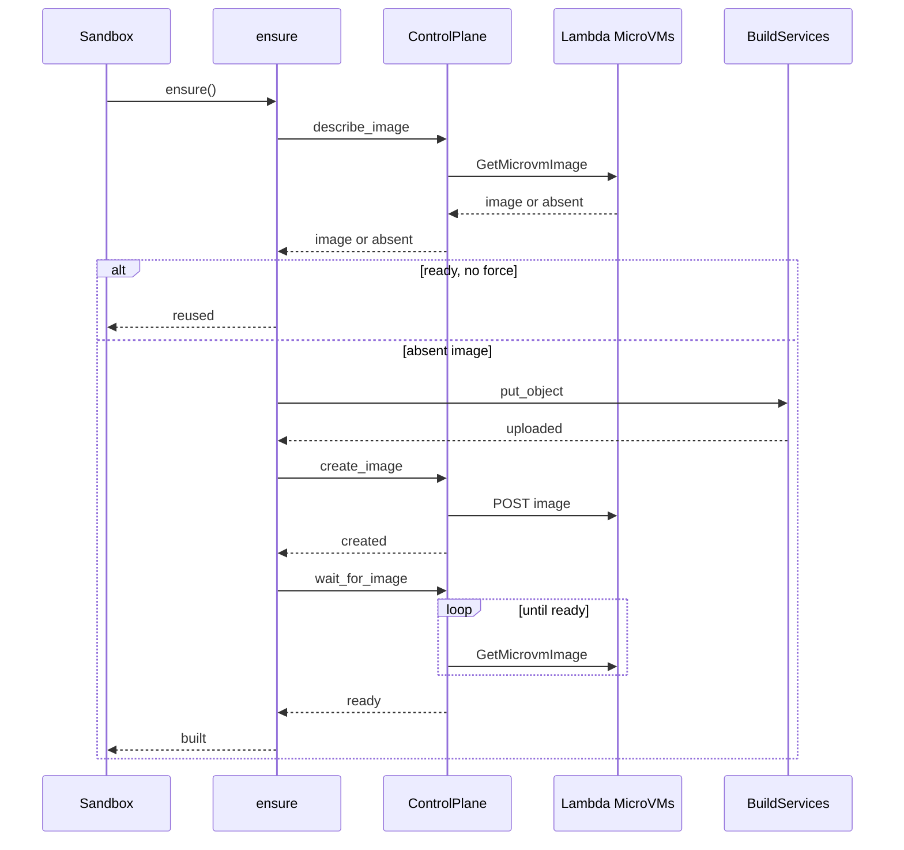
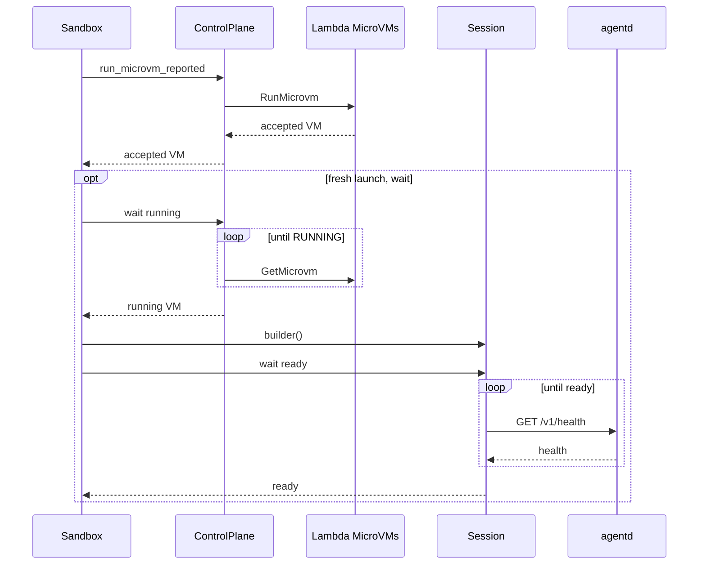
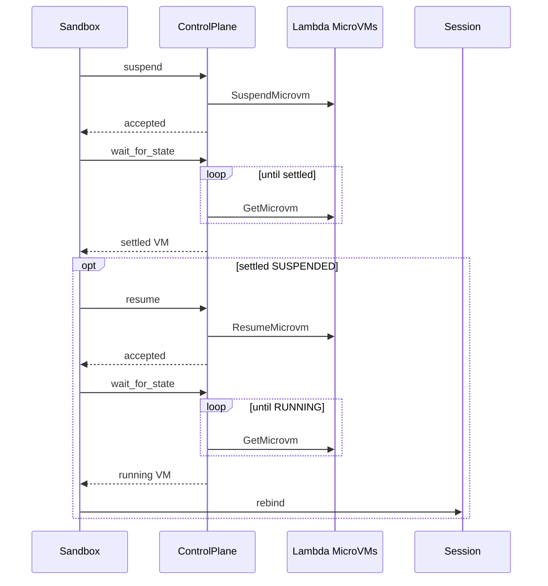

# microvms-agentd · Sequences

## Build or reuse an image

## Launch and wait for readiness

## Suspend and resume

## See also

These pages cite many of the same source files as this one.

- [processes](../../behavior/processes.md)
- [contract map](../../insights/contract-map.md)
- [module map](../../architecture/module-map.md)
- [components](../architecture/components.md)
- [data flow](../../architecture/data-flow.md)
