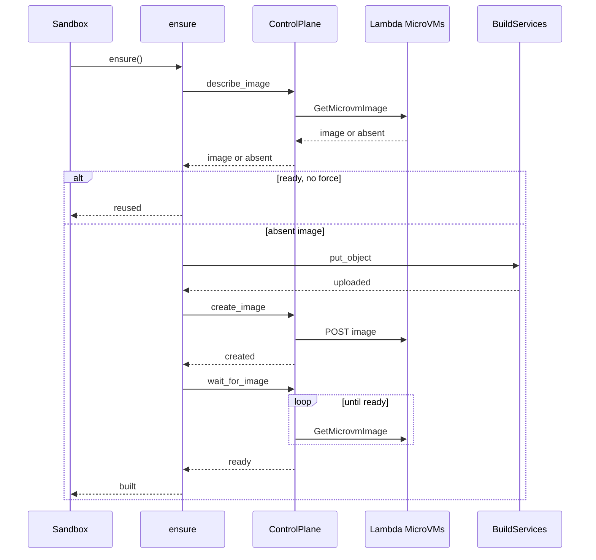
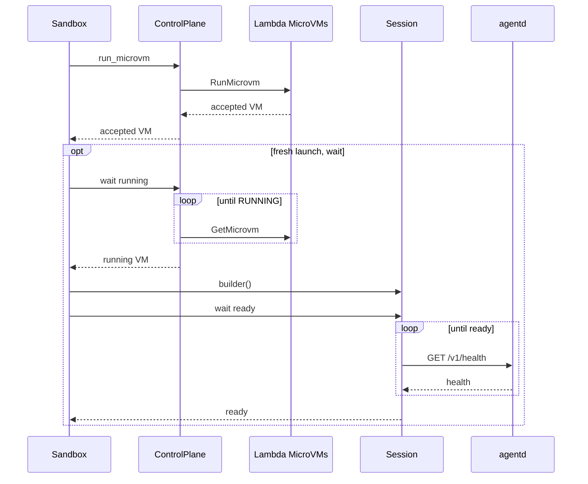
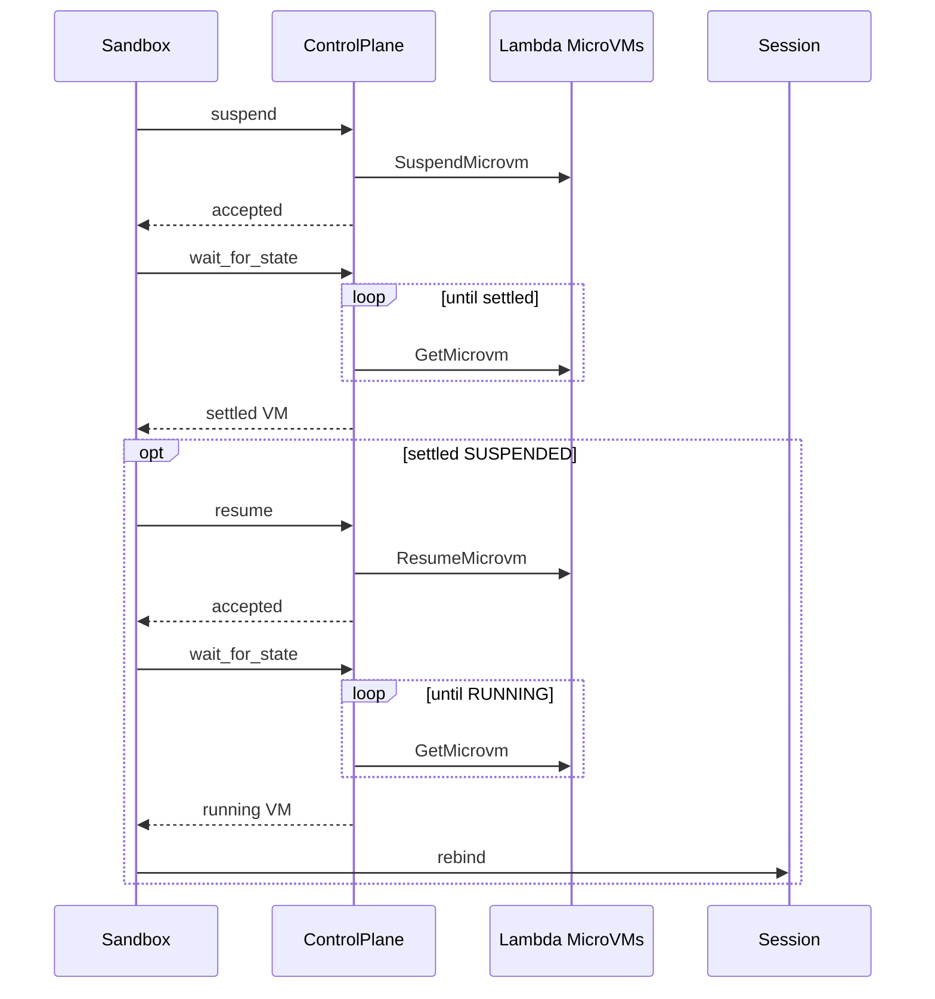

# microvms-agentd · Sequences

## Build or reuse an image

## Launch and wait for readiness

## Suspend and resume

## See also

- [processes](../../behavior/processes.md) — 6 shared source citations
- [contract map](../../insights/contract-map.md) — 6 shared source citations
- [module map](../../architecture/module-map.md) — 5 shared source citations
- [components](../architecture/components.md) — 5 shared source citations
- [data flow](../../architecture/data-flow.md) — 4 shared source citations
