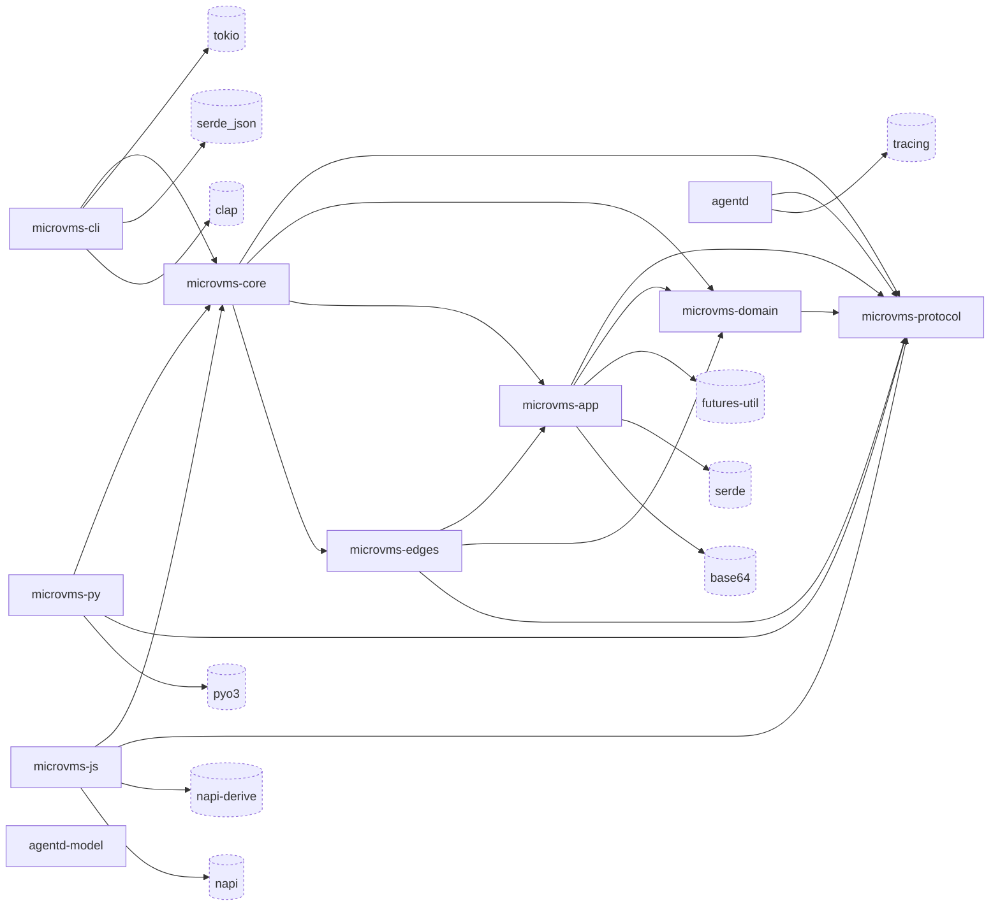

# microvms-agentd · Dependency graph

Arrows point from a Rust crate to a direct dependency. The CLI and bindings use
`microvms-core`; it composes the client layers, while `agentd` uses the shared wire
crate (`crates/microvms-core/Cargo.toml:17-26`,
`crates/microvms-cli/Cargo.toml:38`, `bindings/microvms-py/Cargo.toml:26-32`,
`bindings/microvms-js/Cargo.toml:20-24`, `crates/agentd/Cargo.toml:20`).

The view covers normal dependencies of the workspace crates (`Cargo.toml:2-14`).
Build and development dependencies are excluded. The test-only
`model-conformance` crate has no normal dependencies (`crates/model-conformance/Cargo.toml:18-46`);
its library is intentionally empty (`crates/model-conformance/src/lib.rs:2-7`).

External nodes use dashed cylinders. Their selection follows the number of Rust
source paths that reference each declared dependency's namespace; an external arrow
starts at the crate with the most such paths, with ties resolved by path order.
Other consumers may use the same dependency. Labels use dependency names,
without implying a resolved package version. The inventory and edge counts below
were measured on 2026-10-11 at commit `9729b82`.

## Legend (overflow)

The omitted normal dependencies follow. Edges count source paths with a dependency namespace reference, before
reducing external arrows to a representative consumer. Each declaration links to the manifest that admits the dependency.
The `agentd-model` node's only normal dependency, `stateright`, appears here
(`crates/model/Cargo.toml:13-14`).

| Dependency | Edges | Reason for elision | Declarations |
| --- | --- | --- | --- |
| aws-config | 2 | Too few edges | `crates/microvms-edges/Cargo.toml:41` |
| aws-credential-types | 3 | Too few edges | `crates/microvms-edges/Cargo.toml:47` |
| aws-sigv4 | 3 | Too few edges | `crates/microvms-edges/Cargo.toml:52` |
| axum | 7 | Too few edges | `crates/agentd/Cargo.toml:25` |
| backon | 2 | Too few edges | `crates/microvms-app/Cargo.toml:37`, `crates/microvms-edges/Cargo.toml:66` |
| bytes | 2 | Too few edges | `crates/agentd/Cargo.toml:47` |
| const-hex | 11 | Too few edges | `crates/agentd/Cargo.toml:72`, `crates/microvms-app/Cargo.toml:48`, `crates/microvms-domain/Cargo.toml:50`, `crates/microvms-edges/Cargo.toml:107` |
| getrandom | 3 | Too few edges | `crates/agentd/Cargo.toml:76`, `crates/microvms-edges/Cargo.toml:111` |
| globset | 1 | Too few edges | `crates/microvms-edges/Cargo.toml:130` |
| http | 6 | Too few edges | `crates/microvms-edges/Cargo.toml:64` |
| http-body-util | 2 | Too few edges | `crates/agentd/Cargo.toml:46` |
| jiff | 1 | Too few edges | `crates/microvms-domain/Cargo.toml:41` |
| nix | 5 | Too few edges | `crates/agentd/Cargo.toml:59` |
| notify | 1 | Too few edges | `crates/microvms-cli/Cargo.toml:89` |
| percent-encoding | 2 | Too few edges | `crates/microvms-app/Cargo.toml:50` |
| ratatui | 2 | Too few edges | `crates/microvms-cli/Cargo.toml:50` |
| reqwest | 5 | Too few edges | `crates/microvms-edges/Cargo.toml:58` |
| rust_decimal | 1 | Too few edges | `crates/microvms-domain/Cargo.toml:38` |
| rust_decimal_macros | 1 | Too few edges | `crates/microvms-domain/Cargo.toml:42` |
| schemars | 6 | Too few edges | `crates/agentd/Cargo.toml:86`, `crates/protocol/Cargo.toml:24` |
| sha2 | 5 | Too few edges | `crates/microvms-app/Cargo.toml:43`, `crates/microvms-edges/Cargo.toml:68` |
| sigstore-trust-root | 1 | Too few edges | `crates/microvms-edges/Cargo.toml:84` |
| sigstore-types | 1 | Too few edges | `crates/microvms-edges/Cargo.toml:85` |
| sigstore-verify | 1 | Too few edges | `crates/microvms-edges/Cargo.toml:83` |
| snow | 6 | Too few edges | `crates/agentd/Cargo.toml:100`, `crates/microvms-edges/Cargo.toml:118` |
| stateright | 11 | Too few edges | `crates/model/Cargo.toml:14` |
| subtle | 1 | Too few edges | `crates/agentd/Cargo.toml:53` |
| tar | 2 | Too few edges | `crates/agentd/Cargo.toml:52`, `crates/microvms-edges/Cargo.toml:131` |
| tempfile | 6 | Too few edges | `crates/agentd/Cargo.toml:60` |
| thiserror | 1 | Too few edges | `crates/microvms-domain/Cargo.toml:24` |
| tokio-tungstenite | 2 | Too few edges | `crates/microvms-edges/Cargo.toml:101` |
| tokio-util | 1 | Too few edges | `crates/agentd/Cargo.toml:64` |
| toml | 1 | Too few edges | `crates/microvms-cli/Cargo.toml:76` |
| tower-http | 1 | Too few edges | `crates/agentd/Cargo.toml:34` |
| tracing-subscriber | 1 | Too few edges | `crates/agentd/Cargo.toml:62` |
| unicode-width | 1 | Too few edges | `crates/microvms-cli/Cargo.toml:81` |
| x25519-dalek | 3 | Too few edges | `crates/agentd/Cargo.toml:115`, `crates/microvms-domain/Cargo.toml:56` |
| zip | 3 | Too few edges | `crates/microvms-app/Cargo.toml:41` |

## Internal edges

The declarations and source references below establish the internal arrows. Core's
re-exports preserve a common entry point for client consumers
(`crates/microvms-core/src/lib.rs:93-101`).

| Consumer | Dependencies | Declaration and source evidence |
| --- | --- | --- |
| microvms-cli | microvms-core | `crates/microvms-cli/Cargo.toml:38`; `crates/microvms-cli/src/commands/doctor.rs:17` |
| microvms-core | microvms-domain, microvms-app, microvms-edges, protocol | `crates/microvms-core/Cargo.toml:20-26`; `crates/microvms-core/src/lib.rs:93-101` |
| microvms-app | microvms-domain, protocol | `crates/microvms-app/Cargo.toml:22-24`; `crates/microvms-app/src/lib.rs:61-64` |
| microvms-edges | microvms-app, microvms-domain, protocol | `crates/microvms-edges/Cargo.toml:23-27`; `crates/microvms-edges/src/agents/bedrock.rs:40`; `crates/microvms-edges/src/provision.rs:86`; `crates/microvms-edges/src/identity.rs:23` |
| microvms-domain | protocol | `crates/microvms-domain/Cargo.toml:21`; `crates/microvms-domain/src/identity.rs:20` |
| agentd | protocol | `crates/agentd/Cargo.toml:20`; `crates/agentd/src/exec_start.rs:50` |
| microvms-py | microvms-core, protocol | `bindings/microvms-py/Cargo.toml:26-32`; `bindings/microvms-py/src/errors.rs:27`; `bindings/microvms-py/src/session.rs:98` |
| microvms-js | microvms-core, protocol | `bindings/microvms-js/Cargo.toml:20-24`; `bindings/microvms-js/src/errors.rs:70`; `bindings/microvms-js/src/session.rs:147` |

The dependency-direction tests compare workspace edges against explicit expected
sets (`crates/microvms-cli/tests/dependency_direction.rs:386-397`). This diagram does
not show transitive edges or treat a re-export as a separate dependency.

## External nodes

The retained external nodes have these manifest declarations and representative
source references. The overflow inventory carries the dependencies omitted for
readability.

| Dependency | Representative consumer | Declaration | Source reference |
| --- | --- | --- | --- |
| tokio | microvms-cli | `crates/microvms-cli/Cargo.toml:64` | `crates/microvms-cli/src/main.rs:148` |
| serde_json | microvms-cli | `crates/microvms-cli/Cargo.toml:55` | `crates/microvms-cli/src/envelope.rs:58` |
| clap | microvms-cli | `crates/microvms-cli/Cargo.toml:46` | `crates/microvms-cli/src/cli.rs:45` |
| pyo3 | microvms-py | `bindings/microvms-py/Cargo.toml:45` | `bindings/microvms-py/src/errors.rs:28` |
| futures-util | microvms-app | `crates/microvms-app/Cargo.toml:34` | `crates/microvms-app/src/control/services.rs:12` |
| serde | microvms-app | `crates/microvms-app/Cargo.toml:26` | `crates/microvms-app/src/control/ops.rs:42` |
| napi-derive | microvms-js | `bindings/microvms-js/Cargo.toml:48` | `bindings/microvms-js/src/hooks.rs:29` |
| base64 | microvms-app | `crates/microvms-app/Cargo.toml:46` | `crates/microvms-app/src/session/sse.rs:24` |
| napi | microvms-js | `bindings/microvms-js/Cargo.toml:43` | `bindings/microvms-js/src/errors.rs:71` |
| tracing | agentd | `crates/agentd/Cargo.toml:61` | `crates/agentd/src/main.rs:44` |

## See also

- [system overview](../../architecture/system-overview.md): 19 shared source citations
- [contract map](../../insights/contract-map.md): 13 shared source citations
- [module map](../../architecture/module-map.md): 12 shared source citations
- [impact analysis](../../insights/impact-analysis.md): 9 shared source citations
- [ownership](../../analysis/ownership.md): 7 shared source citations
